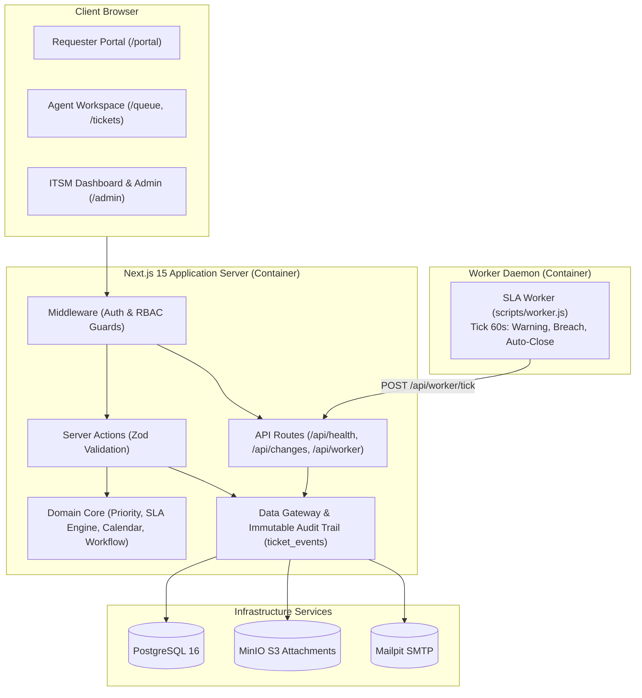

# Sigap — IT Service Desk

> **IT Service Desk berbasis praktik ITIL 4 dengan pelacakan SLA jam kerja akurat (Asia/Jakarta), priority matrix otomatis, audit trail append-only, dan siklus deployment yang tercatat sebagai Change Request.**

[-black?logo=next.js)](https://nextjs.org/)
[](https://www.typescriptlang.org/)
[](https://www.docker.com/)
[](https://vitest.dev/)
[](#praktik-itsm-yang-diterapkan)
[](LICENSE)

---

## ⚡ Quick Start (Jalankan dalam 1 Perintah)

Sigap dirancang **100% mandiri (self-contained)**. Anda tidak perlu menginstal Node.js, pnpm, atau database di mesin lokal. Cukup dengan **Docker Desktop / Docker Engine**:

```bash
git clone https://github.com/jayas/sigap.git
cd sigap
docker compose up -d
```

Buka **[http://localhost:3000](http://localhost:3000)** di browser Anda. Aplikasi langsung terisi dengan **data simulasi historis 90 hari (~900 tiket)**, sehingga dasbor analitik langsung aktif.

---

## 👥 Akun Demo & Persona (1-Click Login)

Di halaman login (`/login`), tersedia tombol **1-Click Login** untuk langsung mencoba alur kerja sesuai peran:

| Peran | Email | Password | Hak Akses Utama |
|---|---|---|---|
| **Requester** (Karyawan) | `user@sigap.demo` | `Demo1234!` | Mengajukan tiket via katalog dinamis, lacak progres, komentar publik, konfirmasi solusi & CSAT |
| **Agent L1** (Staf IT) | `agent@sigap.demo` | `Demo1234!` | Antrean tiket (Queue views), tangani insiden, catatan internal, claim tiket, eskalasi fungsional |
| **Team Lead** (Supervisor) | `lead@sigap.demo` | `Demo1234!` | Reassign tiket tim, override prioritas, pantau SLA tim, eskalasi hierarkis |
| **Administrator** | `admin@sigap.demo` | `Demo1234!` | Konfigurasi sistem (Tim, Pengguna, Katalog, Kebijakan SLA, Kalender & Libur, Kontrol Auto-Assign) |

### 🧭 Rekomendasi Alur Uji Coba (3 Menit):
1. **Requester (`user@sigap.demo`)**: Masuk ke Portal $\rightarrow$ pilih layanan *Reset Password* atau *Akses VPN* $\rightarrow$ kirim tiket.
2. **Agent L1 (`agent@sigap.demo`)**: Buka menu **Antrean Tiket** $\rightarrow$ ambil tiket yang baru dibuat $\rightarrow$ ubah status ke *In Progress* $\rightarrow$ selesaikan (*Resolve*) dengan kode resolusi.
3. **Admin / Lead (`admin@sigap.demo`)**: Buka **Dashboard** untuk melihat metrik SLA compliance, MTTR, dan tren insiden, atau buka menu **Admin** untuk melihat simulasi worker SLA Tick & kontrol auto-assign.

---

## 🌐 Port & Layanan Lokal

Ketika Docker Compose berjalan, layanan berikut dapat diakses di host lokal:

| Layanan | URL Host | Keterangan |
|---|---|---|
| **Sigap Web App** | [http://localhost:3000](http://localhost:3000) | Aplikasi Next.js 15 Standalone |
| **Mailpit (Web Inbox)** | [http://localhost:8025](http://localhost:8025) | Menangkap email/notifikasi aplikasi lokal |
| **MinIO Console** | [http://localhost:9001](http://localhost:9001) | Object storage S3 (`minioadmin` / `minioadmin`) |
| **PostgreSQL 16** | *Internal network* | Database relasional port 5432 (dapat dibuka via compose) |

---

## 🎯 Praktik ITSM yang Diterapkan (ITIL 4 Aligned)

Sigap dibangun untuk mendemonstrasikan pengoperasian layanan IT profesional:

| Praktik ITIL 4 | Fitur di Sigap | Implementasi Kode |
|---|---|---|
| **Service Level Management** | Target Response & Resolution time berbasis kalender jam kerja (08:00–17:00 WIB, exclude weekend & hari libur nasional). SLA otomatis di-pause saat tiket berstatus `Pending`. | [`src/domain/sla.ts`](file:///src/domain/sla.ts), [`src/domain/calendar.ts`](file:///src/domain/calendar.ts) |
| **Incident Management** | Matriks prioritas otomatis (Impact × Urgency = P1..P4). Penegakan guard condition status (`New` $\rightarrow$ `Assigned` $\rightarrow$ `In Progress` $\rightarrow$ `Pending` $\rightarrow$ `Resolved` $\rightarrow$ `Closed`). | [`src/domain/priority.ts`](file:///src/domain/priority.ts), [`src/domain/workflow.ts`](file:///src/domain/workflow.ts) |
| **Service Request Management** | Katalog layanan berjenjang dengan skema formulir dinamis (Custom Form Fields) per item katalog. | [`src/app/(portal)/portal/new/`](file:///src/app/(portal)/portal/new/) |
| **Change Enablement** | Skrip deployment otomatis (`deploy.sh`) mencatatkan setiap deployment versi baru sebagai Change Request (`CHG-xxxxxx`) berstatus `in_progress` lalu `succeeded` atau `rolled_back`. | [`scripts/deploy.sh`](file:///scripts/deploy.sh), [`src/app/api/changes/`](file:///src/app/api/changes/) |
| **Service Desk & Continual Improvement** | Dasbor analitik KPI dengan grafik tren volume harian, SLA compliance rate per prioritas, distribusi umur tiket (aging), MTTR, dan CSAT rating. | [`src/app/(agent)/dashboard/`](file:///src/app/(agent)/dashboard/), [`src/server/queries/dashboard.ts`](file:///src/server/queries/dashboard.ts) |
| **Accountability & Auditability** | Audit trail append-only (`ticket_events`): setiap perubahan status, komentar, penugasan, eskalasi, dan override prioritas dicatat permanen. | [`src/server/mock/ticket-engine.ts`](file:///src/server/mock/ticket-engine.ts) |

---

## 🏗️ Arsitektur Sistem



---

## 📐 Keputusan Arsitektur Utama (ADR Highlights)

Dokumentasi lengkap keputusan teknis tersimpan di [**`docs/DECISIONS.md`**](docs/DECISIONS.md):

* **ADR-001: Worker Periodik vs Timer per Tiket**: Target SLA disimpan sebagai timestamp absolut (`due_at`, `warn_at`) berbasis kalender kerja. Worker berkala memproses tiket yang jatuh tempo, mencegah hilangnya timer in-memory saat deploy/restart.
* **ADR-002: Snapshot SLA Policy per Tiket**: Target SLA dan kalender di-snapshot saat tiket dibuat, sehingga perubahan kebijakan SLA oleh admin tidak merusak data dan komitmen historis.
* **ADR-003: Audit Trail Append-Only**: Tidak ada operasi UPDATE/DELETE pada riwayat kejadian tiket (`ticket_events`). Seluruh perubahan wajib menulis event log baru.
* **ADR-005: Mock Data Gateway In-Memory untuk Evaluasi Portofolio**: Mengizinkan aplikasi dijalankan secara instan dengan isolasi state dan deterministik 90 hari tanpa ketergantungan database eksternal yang rumit saat demonstrasi lokal.
* **ADR-008: Aturan Penugasan Tiket & Eskalasi Ketat**: Agent hanya dapat mengklaim atau melepaskan tiket miliknya sendiri; perpindahan tim oleh agent wajib melalui dialog Eskalasi Fungsional dengan catatan resmi. Team Lead dan Admin memiliki hak intervensi penuh.
* **ADR-009: Simulasi Worker Berkala & Time-Travel Offset**: Admin tab Status Sistem menyediakan pemicu manual SLA Tick dengan opsi *time-travel* (maju 1 jam, 1 hari, 3 hari) untuk memudahkan penguji melihat efek breach dan auto-close secara langsung.

---

## 🛠️ Pengembangan Lokal (Untuk Developer)

Jika Anda ingin menjalankan atau mengembangkan langsung di mesin lokal tanpa Docker:

### Prasyarat
* Node.js >= 20.18
* pnpm 9+

### Menjalankan
```bash
# 1. Install dependensi
pnpm install

# 2. Jalankan dependensi pendukung (opsional: postgres, minio, mailpit)
docker compose -f docker-compose.dev.yml up -d

# 3. Jalankan development server
pnpm dev
```

### Testing & Code Quality
```bash
# Jalankan seluruh unit & integration test
pnpm test

# Type checking TypeScript
pnpm typecheck

# Linter & Formatter check
pnpm lint

# Format otomatis
pnpm format
```

---

## 🧰 Shortcut Makefile

Bagi pengguna Linux, macOS, atau Windows dengan `make`:

```bash
make up        # Menjalankan seluruh stack docker compose dan menunggu healthcheck
make up-build  # Membangun ulang image lokal dan menjalankannya
make down      # Menghentikan container
make reset     # Menghapus volume dan menginisialisasi ulang data demo
make logs      # Melihat streaming log container web dan worker
make test      # Menjalankan lint, typecheck, dan unit test
make deploy    # Menjalankan skrip zero-downtime deploy lokal (deploy.sh)
```

---

## 🔧 Troubleshooting

* **Port 3000 sudah terpakai di komputer Anda**:
  Ubah port host melalui variabel lingkungan:
  ```bash
  SIGAP_PORT=3100 docker compose up -d
  # Buka http://localhost:3100
  ```
* **Ingin mereset seluruh data kembali ke kondisi awal**:
  ```bash
  docker compose down -v
  docker compose up -d
  ```
* **Cek kesehatan aplikasi secara manual**:
  ```bash
  curl http://localhost:3000/api/health
  ```

---

## 📄 Lisensi

Proyek ini dilisensikan di bawah lisensi [MIT](LICENSE).
Dikembangkan untuk portofolio implementasi arsitektur **ITSM & IT Service Management**.
